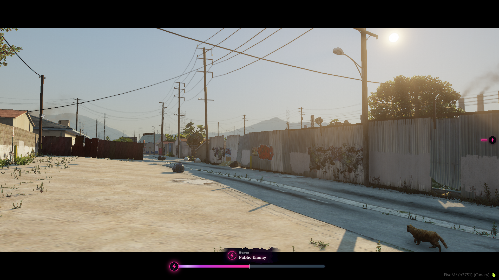
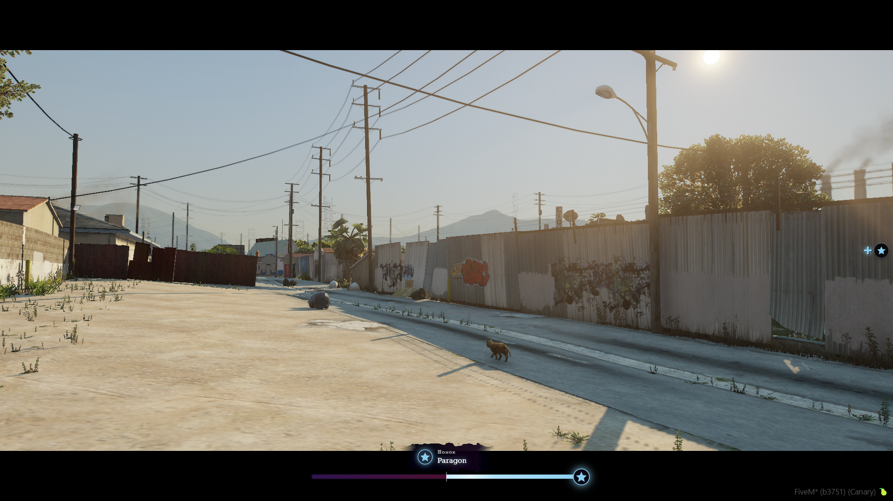

# pena_honor




A persistent honor system for FiveM with a neon bar and an original badge. Good deeds push the bar toward baby blue, crimes push it toward pink and purple. Works with **ESX, QBCore, Qbox or standalone**.

## Features

- Honor changes from named actions (kill a civilian, help a citizen, robbery, and so on), all editable in `config.lua`
- Optional honor pool that batches rapid changes into one smooth update
- Honor saved per character in MySQL, table auto-created on first start
- Statebag sync (`LocalPlayer.state.honor`, `honorTier`) and server exports for other scripts
- On-demand HUD (`/honor`, a key, or the radial menu) with a badge and tier title on top of a long bar
- Slide-in `+` / `-` icon with a round badge for every honor change
- Male and female titles per tier
- Optional Discord webhook logging
- Hooks: `pena_honor:honorAdded` and `pena_honor:honorRemoved`

## Requirements

- [oxmysql](https://github.com/overextended/oxmysql)
- One of ESX, QBCore or Qbox (optional, otherwise it uses the player's license)

## Install

1. Drop `pena_honor` into your resources folder.
2. Add to `server.cfg` after oxmysql and your framework:
   ```
   ensure oxmysql
   ensure pena_honor
   add_ace group.admin pena_honor.admin allow
   ```
3. Adjust `config.lua` and restart.

## Configuration

Everything lives in `config.lua`: framework, honor range, keybind, HUD position (`top-left` to `bottom-right`), duration, colors, pool, actions, tiers and webhook.

## Exports (server)

```lua
exports.pena_honor:AddHonor(src, 25, 'Helped a citizen')
exports.pena_honor:RemoveHonor(src, 40, 'Robbery')
exports.pena_honor:SetHonor(src, 0)
exports.pena_honor:GetHonor(src)
exports.pena_honor:GetTier(src)
exports.pena_honor:ApplyAction(src, 'help_citizen') -- uses Config.Actions
```

Client: `exports.pena_honor:GetHonor()` and `exports.pena_honor:ShowHonor()`.

## Hooks

```lua
AddEventHandler('pena_honor:honorAdded', function(src, delta, newValue, reason) end)
AddEventHandler('pena_honor:honorRemoved', function(src, delta, newValue, reason) end)
```

## Commands

- `/honor` shows the bar (also bound to a key)
- `/sethonor [id] [value]` and `/addhonor [id] [amount]` for admins (ace `pena_honor.admin`)

## Checking honor, key and radial menu

- `/honor` shows the bar. It is also bound to a key (`Config.Keybind`, default `F7`; players can rebind it in Settings > Key Bindings > FiveM). Set `Config.Keybind = false` to have no key at all.
- If ox_lib is running, an **Honor** item is added to its radial menu (`Config.Radial`). For a custom radial menu make its item run `ExecuteCommand('honor')` or `exports.pena_honor:ShowHonor()`.

## Sounds

Native GTA sounds play for honor gained and lost, reaching a better or worse tier, opening and closing the bar, and a shop refusing you. Each one is a `{ name, set }` pair in `Config.Sounds`; set one to `false` to mute it or `enabled = false` to mute everything.

## Troubleshooting

If an action doesn't change honor, set `Config.Debug = true`, restart the resource and repeat it. The F8 console shows what the client detected (victim type, whether it counted as a kill, hostile or civilian, and what it reported) and the server console shows what it received and whether it was applied or rejected.

## Where honor comes from

Detected automatically (client detects, server validates):

| Action | Honor | Trigger |
| --- | --- | --- |
| `kill_civilian` | -40 | Killing a peaceful ped (also by running them over) |
| `kill_player` | -75 | Killing another player |
| `kill_cop` | -60 | Killing a police officer ped |
| `hit_civilian` | -8 | Hurting a peaceful ped without killing (once per ped per minute) |
| `kill_animal` | -15 | Killing a pet or livestock (`Config.AutoDetect.protectedAnimals`) |
| `threaten_civilian` | -3 | Keeping a weapon aimed at a peaceful ped for 3 seconds (once per ped per minute) |
| `carjack` | -25 | Pulling a ped out of the driver seat of their vehicle |
| `kill_hostile` | +5 | Killing a ped that was fighting you, or a gang member (max 30/hour) |
| `kill_outlaw` | +30 | Killing a player whose honor is at or below `Config.OutlawHonor` (decided by the server, max 90/hour) |

Triggered by your other resources with `exports.pena_honor:ApplyAction(src, 'key')`: `help_citizen`, `revive_player`, `arrest`, `donation`, `job_done`, `robbery`, `heist`, `steal_vehicle`, `mugging`, `jailed`. You can also hook them without editing the other resource through `Config.Listeners`.

`/honoraction [id] [action]` (admin) runs any action for testing.

## Your own activities

Every honor change comes from an action in `Config.Actions` (label, amount, optional `maxPerHour`, `cooldown`, `enabled`). Add your own in two ways.

**1. In config.lua**, then trigger it from any server script:

```lua
-- config.lua
Config.Actions.delivery_done = { label = 'Honest delivery', amount = 5, cooldown = 120, maxPerHour = 30 }

-- your resource (server)
exports.pena_honor:ApplyAction(src, 'delivery_done')
```

**2. From your own resource, without editing pena_honor:**

```lua
exports.pena_honor:RegisterAction('delivery_done', { label = 'Honest delivery', amount = 5, cooldown = 120, maxPerHour = 30 })
exports.pena_honor:ApplyAction(src, 'delivery_done')
```

Registered actions disappear when your resource stops, can't overwrite actions from `config.lua`, and can only be applied from the server. Use a negative `amount` for a crime. You can also skip code with `Config.Listeners` (apply an action when another resource fires a server event) and switch off any built-in detection with `enabled = false`. `exports.pena_honor:GetActions()` lists everything registered.

Always trigger positive actions from your own server-side checks (finished job, completed delivery), never straight from a client event, and use `cooldown` and `maxPerHour` so they can't be farmed.

## Benefits and penalties

Honor puts every player in one of three groups, decided by the `mood` of their tier:

- **Good** tiers can get benefits (`Config.Benefits`).
- **Neutral** tiers (default honor) get nothing.
- **Bad** tiers get penalties (`Config.Penalties`).

This is enforced in code, so listing the wrong tier in the config has no effect. Each entry is a name with a value per tier id.

```lua
-- config.lua
Config.Benefits = {
    shop_discount = { decent = 5, honorable = 10, noble = 15, paragon = 20 },
}
Config.Penalties = {
    extra_prices = { scoundrel = 25, public_enemy = 50 },
}

-- server
local value = exports.pena_honor:GetBenefit(src, 'shop_discount')   -- number, or nil if the player doesn't qualify
local value = exports.pena_honor:GetPenalty(src, 'extra_prices')    -- number, or nil
local all   = exports.pena_honor:GetBenefits(src)                   -- { shop_discount = 10, ... }
local all   = exports.pena_honor:GetPenalties(src)
local ok    = exports.pena_honor:HasTier(src, 'honorable')          -- honorable or higher
local ok    = exports.pena_honor:HasMinHonor(src, 350)

-- client (for UIs)
exports.pena_honor:GetBenefit('shop_discount')
exports.pena_honor:GetPenalty('extra_prices')
-- or read the statebags: LocalPlayer.state.honorBenefits, honorPenalties, honorTier
```

Nothing is built in for good honor, so you can build your own: discounts, job perks, better rewards, access to areas. React to tier changes with:

```lua
AddEventHandler('pena_honor:tierChanged', function(src, newTier, oldTier, honor) end) -- server
RegisterNetEvent('pena_honor:client:tierChanged', function(newTier, oldTier, honor) end) -- client
```

### Built-in penalties for bad honor

| Penalty | What it does | Default (rogue / scoundrel / public enemy) |
| --- | --- | --- |
| `refuse_service` | ox_inventory shops refuse to open. Value is the percent chance per attempt. A refused shop keeps refusing for `Config.ShopRefusal.memory` seconds. | 25 / 60 / 100 |
| `npc_fear` | Peds near you react and flee. Value is the radius in meters. | 5 / 8 / 12 |

Both can be switched off (`Config.ShopRefusal.enabled`, `Config.NpcFear.enabled`) or tuned per tier in `Config.Penalties`. Other store scripts can use the refusal too:

```lua
if exports.pena_honor:ShouldRefuseService(src, 'my_shop') then return end -- tells the player and plays a sound
```

## Ideas

Scale police response or bounties with low honor, gate jobs or areas by tier, or read `Player(src).state.honor` from any HUD or scoreboard.

## Notes

Kill detection runs on the client and is validated by the server (only actions marked `auto = true`, with a cooldown). Positive actions should always be triggered server-side through the exports.

## License

MIT, see `LICENSE`.

## Honor change icon

Every honor change slides a big `+` or `-` with a round badge in from the side of the screen (baby blue for good, pink and purple for bad). Configure it with `Config.Notify` (position, duration, stack size, optional reason text).